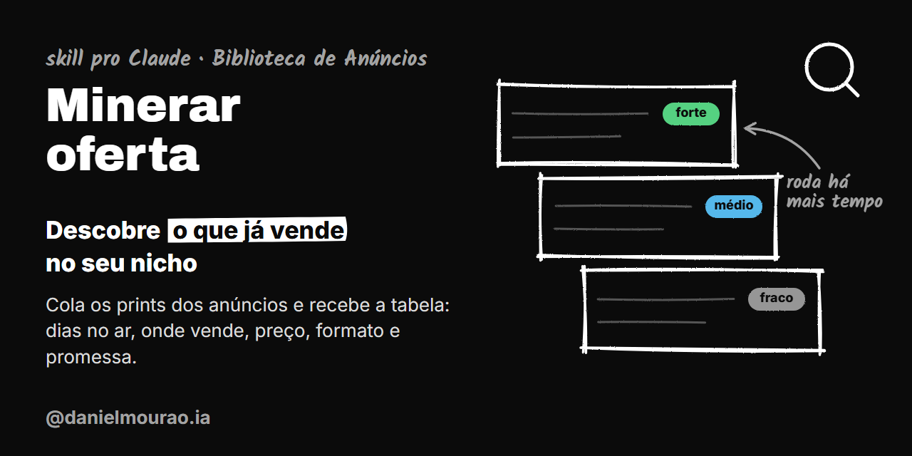
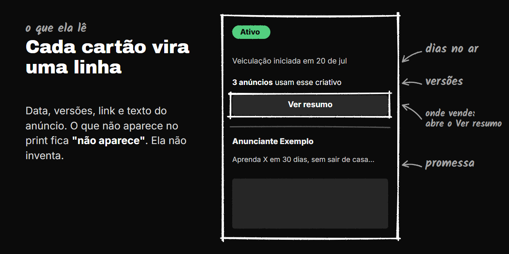
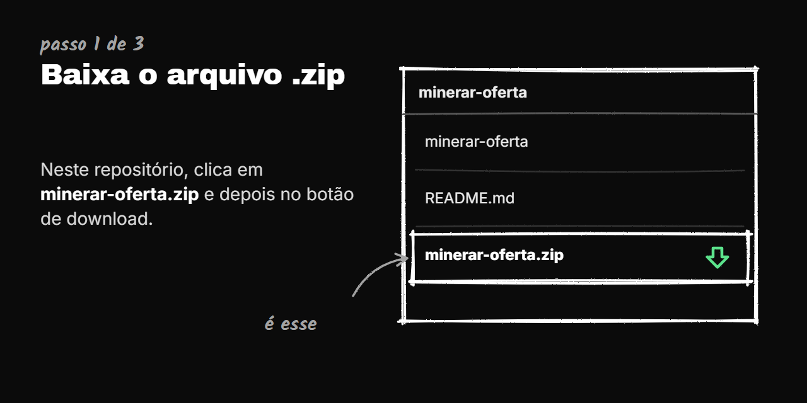
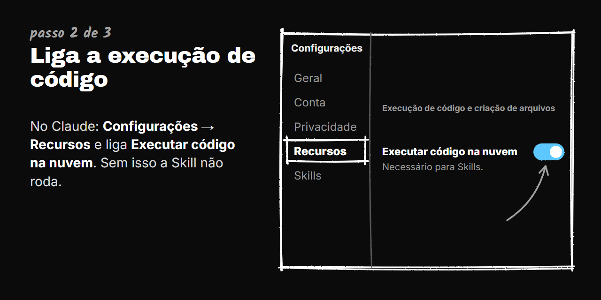
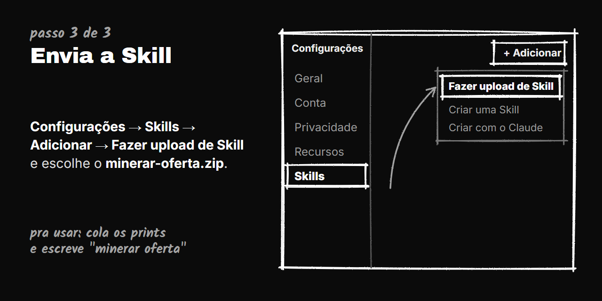

<a id="topo"></a>

<p align="center">
  
</p>

# Minerar oferta

**Uma Skill pro Claude que descobre o que já vende no seu nicho.**<br>
Você cola prints da Biblioteca de Anúncios da Meta, ela devolve a tabela das ofertas e o padrão do nicho.

Claude (Skill) · claude.ai e Claude Code · Biblioteca de Anúncios grátis, sem login

**[↓ BAIXAR A SKILL](minerar-oferta.zip)** · **[→ COMO INSTALAR](#02--instalar-no-claudeai)** · **[→ COMO TIRAR OS PRINTS](#01--tirar-os-prints)** · **[↗ @DANIELMOURAO.IA](https://www.tiktok.com/@danielmourao.ia)**

---

## 00 / O que ela faz

| | O que você recebe |
|---|---|
| **Tabela** | Uma linha por anúncio: anunciante, início, dias no ar, versões, onde vende, preço, formato e promessa. |
| **Sinal** | Forte, médio ou fraco, pelo tempo no ar e pelo número de versões. |
| **Padrão do nicho** | Formato, faixa de preço, promessa e plataforma que mais se repetem, com "X de N anúncios". |
| **Próximo passo** | O que olhar no checkout dos fortes: preço, order bump, garantia. |

> **Por que funciona:** ninguém paga anúncio por meses no prejuízo. Anúncio que roda há muito tempo, com várias versões, costuma ser oferta que vende. **É sinal, não garantia de venda.**



**Regra de ouro:** ela não inventa. Preço, link ou formato que não aparece no print fica como **"não aparece"**.

---

## 01 / Tirar os prints

Grátis e sem login. Leva uns 3 minutos.

1. Abre [facebook.com/ads/library](https://www.facebook.com/ads/library).
2. País: **Brasil**. Categoria: **Todos os anúncios**.
3. Pesquisa uma palavra do nicho: `emagrecer`, `renda extra`, `reconquistar`…
4. **Filtros → Status online → Anúncios ativos**.
5. **Classificar por → Impressões: do mais alto ao mais baixo**.
6. Tira print de **5 a 10 cartões inteiros**, do "Ativo" no topo até o botão no rodapé.
7. Cartão com "N anúncios usam esse criativo e esse texto" esconde o link. Clica em **Ver resumo** e tira print de um cartão de dentro: é ali que aparece o site.

> **Mínimo de 3 cartões.** Com menos, a Skill pede mais prints antes de montar a tabela.

---

## 02 / Instalar no claude.ai

Pra quem tem **Claude pago**. Leva uns 2 minutos.

**1. Baixa o arquivo.** Clica em [`minerar-oferta.zip`](minerar-oferta.zip) e depois no botão de download.



**2. Liga a execução de código.** No Claude: **Configurações → Recursos** e liga **Executar código na nuvem**.



**3. Envia a Skill.** **Configurações → Skills → Adicionar → Fazer upload de Skill** e escolhe o `minerar-oferta.zip`.



| Pra usar | Escreve |
|---|---|
| **Minerar** | cola os prints e escreve `minerar oferta, nicho emagrecimento` |
| **Só o passo a passo** | `como tiro os prints pra minerar oferta?` |

---

## 03 / Instalar no Claude Code

Copia a pasta `minerar-oferta/` (a que tem o `SKILL.md`) pra pasta de Skills:

| Vale pra | Pasta |
|---|---|
| **Todos os seus projetos** | `~/.claude/skills/minerar-oferta/` |
| **Só um projeto** | `.claude/skills/minerar-oferta/` dentro do projeto |

Depois abre o Claude Code, arrasta os prints pro terminal e escreve `minerar oferta, nicho …`.

---

## 04 / Exemplo de saída

> **Exemplo inventado**, só pra mostrar o formato. Anunciantes, sites e números são fictícios.

**1. Tabela** · Dias no ar contados até 17/11/2026.

| # | Anunciante | Início | Dias no ar | Versões | Onde vende | Preço | Formato | Promessa | Sinal |
|---|---|---|---|---|---|---|---|---|---|
| 1 | Exemplo Fit A | 10/05/2026 | 191 | 4 | Hotmart | não aparece | curso | secar a barriga treinando 15 minutos | Forte |
| 2 | Exemplo Receitas B | 02/08/2026 | 107 | 1 | site próprio (seusite.com.br) | R$ 27 | e-book | 50 receitas pra emagrecer sem passar fome | Médio |
| 3 | Exemplo Clínica C | 20/09/2026 | 58 | várias | WhatsApp | não aparece | serviço local | perder peso com acompanhamento semanal | Forte |
| 4 | Exemplo Mentor D | 09/11/2026 | 8 | 1 | não aparece | não aparece | não aparece | emagrecer depois dos 40 sem academia | Fraco |

**2. Avisos** · Exemplo Clínica C é serviço local (atende uma região, compare com cuidado).

**3. Padrão do nicho** · Formato: sem padrão ainda (cada um aparece 1 vez) · Preço: 1 de 4 mostra preço (R$ 27) · Promessa: emagrecer sem sofrimento, 2 de 4 · Plataforma: sem padrão ainda (cada uma aparece 1 vez).

**4. Próximo passo** · Abre o link dos fortes e olha no checkout: preço, order bump, garantia e parcelamento.

**É sinal, não garantia de venda.**

---

## 05 / Opcional: conector oficial da Meta

Se você ligou o conector oficial da Meta (`https://mcp.facebook.com/ads`), a Skill pode buscar direto na Biblioteca de Anúncios, sem print.

> **Atenção:** o conector exige **conta de anúncio ativa** e também consegue **mexer na conta** (criar, pausar, gastar). Aqui ele serve só pra pesquisa: **não autorize nenhuma mudança na conta.** Sem o conector, os prints fazem o mesmo trabalho.

---

## 06 / O que tem aqui

```text
minerar-oferta/
├── minerar-oferta/
│   └── SKILL.md          a Skill: texto puro, sem código, sem acesso à internet
├── minerar-oferta.zip    a mesma Skill, pronta pra enviar no Claude
└── assets/               imagens deste README (telas desenhadas, nenhum anúncio real)
```

> **Segurança:** é um arquivo de texto só. Dá pra abrir o `SKILL.md` e ler tudo antes de instalar.

---

<p align="center">
  <b>QUEM RODA HÁ MAIS TEMPO DÁ A PISTA. COMEÇA POR AÍ.</b><br><br>
  Menus da Biblioteca de Anúncios e do Claude conferidos em português em 17/11/26. Se o nome mudar, procura "Skills" nas Configurações.<br>
  <a href="https://www.tiktok.com/@danielmourao.ia">@danielmourao.ia no TikTok</a> · <a href="#topo">↑ voltar ao topo</a>
</p>
